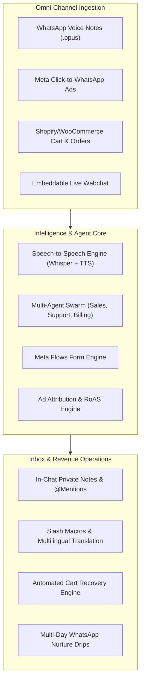
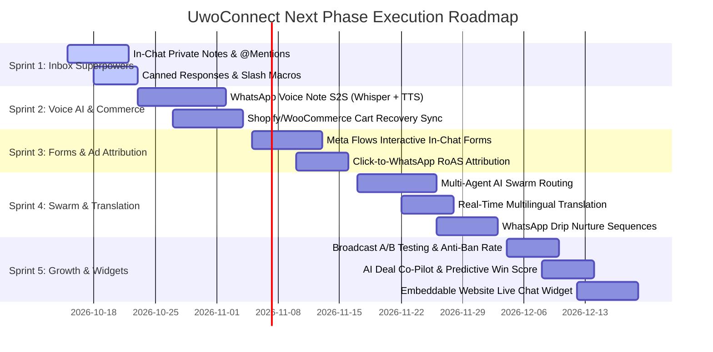

# 🚀 UwoConnect — Next Phase Product Specification & Technical Architecture (v4.0 & v5.0)

> **Document Type**: Product Requirements Document (PRD) & Technical Architecture Specification  
> **Target Release**: Q4 2026 – Q1 2027  
> **Platform Scope**: `UWO-CONNECT_B` (Django 5.2 / Daphne / MongoDB Atlas) & `UWO-Connect_F` (Next.js 15.1 / React 19)  
> **Status**: Approved for Implementation  

---

## 📑 Table of Contents
1. [Executive Summary & Product Vision](#1-executive-summary--product-vision)
2. [Feature Priority & Impact Matrix](#2-feature-priority--impact-matrix)
3. [Deep-Dive Technical Specifications](#3-deep-dive-technical-specifications)
   - [3.1 Autonomous WhatsApp Voice Note AI Agent (Speech-to-Speech)](#31-autonomous-whatsapp-voice-note-ai-agent-speech-to-speech)
   - [3.2 In-Chat Private Team Collaboration & @Agent Mentions](#32-in-chat-private-team-collaboration--agent-mentions)
   - [3.3 Native WhatsApp Interactive Forms (Meta Flows API)](#33-native-whatsapp-interactive-forms-meta-flows-api)
   - [3.4 Shopify & WooCommerce 2-Way Sync + WhatsApp Abandoned Cart Funnel](#34-shopify--woocommerce-2-way-sync--whatsapp-abandoned-cart-funnel)
   - [3.5 Meta Click-to-WhatsApp (CTWA) Ad Attribution & RoAS Dashboard](#35-meta-click-to-whatsapp-ctwa-ad-attribution--roas-dashboard)
   - [3.6 Quick Slash Shortcuts & Canned Response Macros](#36-quick-slash-shortcuts--canned-response-macros)
   - [3.7 Specialized Multi-Agent AI Swarm (Sales, Support, Billing)](#37-specialized-multi-agent-ai-swarm-sales-support-billing)
   - [3.8 Real-Time Multilingual Chat Translation](#38-real-time-multilingual-chat-translation)
   - [3.9 WhatsApp Drip & Lead Nurture Sequences](#39-whatsapp-drip--lead-nurture-sequences)
   - [3.10 Broadcast A/B Content Testing & Anti-Ban Rate Pacing](#310-broadcast-ab-content-testing--anti-ban-rate-pacing)
   - [3.11 AI Deal Co-Pilot & Predictive Win-Probability in CRM](#311-ai-deal-co-pilot--predictive-win-probability-in-crm)
   - [3.12 Embeddable Website Live Chat Widget](#312-embeddable-website-live-chat-widget)
4. [Database Taxonomy & Schema Additions](#4-database-taxonomy--schema-additions)
5. [New API Route Contracts](#5-new-api-route-contracts)
6. [Phased Implementation Roadmap & Sprints](#6-phased-implementation-roadmap--sprints)

---

## 1. Executive Summary & Product Vision

UwoConnect has established a rock-solid, 100% verified baseline covering omni-channel messaging (WhatsApp Cloud, Instagram DM, Facebook Messenger, YouTube, Gmail, Outlook), ReactFlow visual automations, GST sales documents, double-entry wallet metering, and white-labeling.

The **Next Phase (v4.0 & v5.0)** focuses on evolving UwoConnect from a **reactive messaging CRM** into an **autonomous, revenue-generating conversational commerce engine**. 



---

## 2. Feature Priority & Impact Matrix

| # | Feature Name | Primary Scope | Business Value | Tech Complexity | Priority |
| :---: | :--- | :--- | :---: | :---: | :---: |
| **1** | **In-Chat Private Notes & @Mentions** | Unified Inbox | ⭐⭐⭐⭐⭐ (Daily Utility) | Medium | **P0 (Sprint 1)** |
| **2** | **Slash Shortcuts & Canned Macros** | Unified Inbox | ⭐⭐⭐⭐⭐ (Agent Speed) | Low | **P0 (Sprint 1)** |
| **3** | **WhatsApp Voice Note AI Agent (S2S)** | AI & WhatsApp | ⭐⭐⭐⭐⭐ (Massive Market) | High | **P1 (Sprint 2)** |
| **4** | **Shopify & WooCommerce Cart Recovery** | E-Commerce | ⭐⭐⭐⭐⭐ (Direct GMV) | High | **P1 (Sprint 2)** |
| **5** | **WhatsApp Native Flows (Forms API)** | WhatsApp Automation | ⭐⭐⭐⭐⭐ (Lead Quality) | Medium | **P1 (Sprint 3)** |
| **6** | **Meta CTWA Ad Attribution & RoAS** | Analytics & CRM | ⭐⭐⭐⭐ (Agency Value) | Medium | **P2 (Sprint 3)** |
| **7** | **Multi-Agent AI Swarm Routing** | Conversational AI | ⭐⭐⭐⭐ (Accuracy) | High | **P2 (Sprint 4)** |
| **8** | **Multilingual Real-Time Translation** | Unified Inbox | ⭐⭐⭐⭐ (Global Reach) | Medium | **P2 (Sprint 4)** |
| **9** | **WhatsApp Drip & Nurture Sequences** | Automation Engine | ⭐⭐⭐⭐ (Retention) | Medium | **P2 (Sprint 4)** |
| **10**| **Broadcast A/B Content Testing & Anti-Ban Pacing**| Broadcasts | ⭐⭐⭐⭐ (Compliance) | Medium | **P3 (Sprint 5)** |
| **11**| **AI Deal Co-Pilot & Win Probability** | CRM Pipeline | ⭐⭐⭐ (Deal Closing) | High | **P3 (Sprint 5)** |
| **12**| **Embeddable Website Live Chat Widget** | Multi-Channel | ⭐⭐⭐ (Lead Ingestion) | Medium | **P3 (Sprint 5)** |

---

## 3. Deep-Dive Technical Specifications

### 3.1 Autonomous WhatsApp Voice Note AI Agent (Speech-to-Speech)
* **Problem**: Over 40% of WhatsApp inquiries in India, the Middle East, and Latin America are submitted as audio voice notes. Current bots fail because they only parse text payloads.
* **Architecture**:
  ```mermaid
  sequenceDiagram
      autonumber
      actor Customer as WhatsApp Customer
      participant Meta as Meta Graph Webhook
      participant AudioSvc as Voice Note Service
      participant Whisper as OpenAI Whisper API
      participant RAG as RAG Knowledge Engine
      participant TTS as TTS Audio Engine
      participant Client as Live Inbox Agent

      Customer->>Meta: Inbound Voice Note (.ogg / .opus)
      Meta->>AudioSvc: Webhook dispatch with media_id
      AudioSvc->>AudioSvc: Download & save to Cloud Storage
      AudioSvc->>Whisper: Transcribe audio to text
      Whisper-->>AudioSvc: Text: "Bhaiya quotation kab tak milega?"
      AudioSvc->>Client: Broadcast transcript to WebSocket room
      AudioSvc->>RAG: Query Knowledge base with transcript
      RAG-->>AudioSvc: Response text generated
      AudioSvc->>TTS: Synthesize natural voice (Hindi/English)
      TTS-->>AudioSvc: Audio buffer (.ogg opus)
      AudioSvc->>Meta: Dispatch voice note to customer WhatsApp
      Meta-->>Customer: Playable voice note delivered
  ```
* **Key Implementation Steps**:
  1. Add audio format normalization in [`media_storage_service.py`](file:///b:/Uwo_Connect/UWO-CONNECT_B/api/services/media_storage_service.py) supporting `.ogg` / `.opus` / `.mp3`.
  2. Implement `transcribe_voice_note(audio_url)` using OpenAI Whisper API.
  3. Implement `synthesize_voice_response(text, language='hi', voice='alloy')` returning OGG Opus format matching WhatsApp voice note audio specifications (`audio/ogg; codecs=opus`).
  4. Send via Meta Graph API with parameter `{"messaging_product": "whatsapp", "type": "audio", "audio": {"link": audio_url}}`.

---

### 3.2 In-Chat Private Team Collaboration & @Agent Mentions
* **Problem**: When a customer asks a complex technical question or requests a custom discount, agents currently discuss it in external tools (Slack/WhatsApp), losing deal context.
* **Architecture**:
  - Extend [`Message`](file:///b:/Uwo_Connect/UWO-CONNECT_B/api/models.py) model with fields:
    - `is_internal_note`: `BooleanField(default=False)`
    - `mentioned_users`: `ManyToManyField(User, blank=True)`
  - **WebSocket Dispatch**: Dispatches WebSocket event `type: 'internal_note_added'` to `inbox_{client_id}`.
  - **Frontend UI**:
    - Dual tabs above composer in [`inbox/page.jsx`](file:///b:/Uwo_Connect/UWO-Connect_F/src/app/client/inbox/page.jsx): **[Send to Customer]** vs **[Internal Note 🔒]**.
    - Internal notes render with a distinctive yellow/amber container, padlock icon, and author avatar.
    - Tagging an agent with `@username` sends a real-time browser notification and plays a chime alert.

---

### 3.3 Native WhatsApp Interactive Forms (Meta Flows API)
* **Problem**: Multi-step conversational bots require 5–8 messages to collect simple details (Name, Email, Model, Date), leading to a 60% drop-off rate.
* **Architecture**:
  ```mermaid
  graph LR
      Chat["WhatsApp Chat Timeline"] -->|Tap 'Book Demo'| Flow["Native Mobile Bottom-Sheet Form"]
      Flow -->|Fill: Name, Date, Service, City| MetaServers["Meta Flow Engine"]
      MetaServers -->|Signed Flow JSON Payload| Backend["/api/meta/flows/data-exchange/"]
      Backend --> Contact["Auto-Create Contact"]
      Backend --> CRM["Auto-Create Deal in Pipeline"]
      Backend --> Confirm["Auto-Send WhatsApp Confirmation"]
  ```
* **Key Components**:
  - **Meta Flow Builder UI**: Visual drag-and-drop form creator in UwoConnect (Text fields, Dropdowns, DatePickers, Radio groups).
  - **Data Exchange Webhook**: Endpoint `/api/meta/flows/endpoint/` for dynamic form population (e.g. fetching available appointment slots dynamically).
  - **Encrypted Decryption**: Decrypts Meta Flow responses using the client's private RSA key.

---

### 3.4 Shopify & WooCommerce 2-Way Sync + WhatsApp Abandoned Cart Funnel
* **Problem**: E-commerce stores lose 70% of potential orders to cart abandonment. Standard email reminders have less than 15% open rates.
* **Capabilities**:
  1. **2-Way Store Sync**: Connects store via OAuth; syncs Products, Variants, Inventory, Customers, and Orders.
  2. **Automated Cart Abandonment Webhook**:
     - Webhook receives `checkouts/create` and `checkouts/update`.
     - Starts a 30-minute grace timer.
     - If `orders/create` is not received within 30 minutes, triggers an automated personalized WhatsApp template:
       > *"Hi {{first_name}}! 🛍️ You left {{item_count}} items in your cart at {{store_name}}. Complete your order in the next 2 hours and get 10% OFF with code FLASH10 👇"*
     - Contains an interactive **"Complete Order"** button deep-linked to the pre-filled checkout.
  3. **Order Lifecycle Alerts**: Instant automated WhatsApp notifications on `Order Confirmed`, `Order Dispatched (with tracking link)`, and `Delivered`.

---

### 3.5 Meta Click-to-WhatsApp (CTWA) Ad Attribution & RoAS Dashboard
* **Problem**: Businesses spend thousands on Facebook & Instagram ads pointing to WhatsApp, but cannot measure how much revenue each specific ad generated.
* **Architecture**:
  - Inbound webhook extracts Meta's `referral` object:
    ```json
    "referral": {
      "source_type": "ad",
      "source_id": "23849182391290",
      "source_url": "https://fb.me/...",
      "headline": "Flat 30% Off ERP Software",
      "body": "Upgrade your business today"
    }
    ```
  - Attaches `ad_id`, `ad_headline`, and `ad_campaign` to the [`Contact`](file:///b:/Uwo_Connect/UWO-CONNECT_B/api/models.py) record.
  - When the contact buys a product on `/checkout/` or pays an invoice via Razorpay, the transaction is tagged with the `ad_id`.
  - **Dashboard Metrics**: Computes **Cost per Lead (CPL)**, **Conversion Rate**, and **Return on Ad Spend (RoAS = Closed Revenue / Ad Spend)**.

---

### 3.6 Quick Slash Shortcuts & Canned Response Macros
* **Problem**: Agents spend up to 35% of their day repeatedly typing identical company details, bank accounts, and pricing plans.
* **Capabilities**:
  - Global & Client-specific macros stored in new model [`CannedResponse`](file:///b:/Uwo_Connect/UWO-CONNECT_B/api/models.py).
  - Typing `/` triggers an autocomplete dropdown in the message composer.
  - **Dynamic Variable Substitution**:
    - `{{contact.name}}` ➔ Customer's full name.
    - `{{contact.phone}}` ➔ Phone number.
    - `{{agent.name}}` ➔ Assigned agent name.
    - `{{business.name}}` ➔ Workspace business name.
    - `{{business.upi_id}}` ➔ Workspace UPI ID.
  - **One-Click Media Attachments**: Macros can bundle pre-saved PDF brochures, pricing sheets, or company introductory videos.

---

### 3.7 Specialized Multi-Agent AI Swarm (Sales, Support, Billing)
* **Problem**: A single prompt cannot simultaneously be a persuasive sales closer, an accurate technical debugger, and a compliant billing accountant.
* **Swarm Architecture**:
  ```mermaid
  graph TB
      Inbound["Customer Message"] --> Supervisor["Supervisor / Intent Router Agent"]
      Supervisor -->|Pricing, Demo, Discount| SalesAgent["Sales Closer Agent<br/>(Pitches, Objections, Checkout Links)"]
      Supervisor -->|Error, How-to, Manual| SupportAgent["Technical Support Agent<br/>(PDF Knowledge Retrieval)"]
      Supervisor -->|GST, Receipt, Refund| BillingAgent["Billing Agent<br/>(Invoice Search, Tax, Ledger)"]
      SalesAgent --> ContextBridge["Shared Conversation Memory"]
      SupportAgent --> ContextBridge
      BillingAgent --> ContextBridge
  ```
* **Handoff Protocols**: Each agent has specialized tool access:
  - *Sales Agent*: `create_payment_link`, `apply_discount`, `check_calendar_availability`, `book_appointment`.
  - *Support Agent*: `search_knowledge_documents`, `create_support_ticket`.
  - *Billing Agent*: `fetch_invoice_pdf`, `verify_payment_status`, `check_wallet_balance`.

---

### 3.8 Real-Time Multilingual Chat Translation
* **Problem**: Support teams operating in metropolitan hubs frequently lose deals when customers reach out in regional Indian languages (Tamil, Telugu, Marathi, Bengali, Gujarati, Kannada).
* **Capabilities**:
  - Automatic language detection on incoming messages.
  - Inline preview showing translated text to the agent in English.
  - Composer feature: **"Translate & Send"** — agent types in English, system translates into the customer's native language before dispatching to WhatsApp.
  - Toggle option for automatic translation logs stored in message audit history.

---

### 3.9 WhatsApp Drip & Lead Nurture Sequences
* **Problem**: One-off broadcasts have high decay. Converting high-ticket B2B leads requires 4–7 touches over 14 days.
* **Architecture**:
  - New models: [`DripSequence`](file:///b:/Uwo_Connect/UWO-CONNECT_B/api/models.py), [`DripStep`](file:///b:/Uwo_Connect/UWO-CONNECT_B/api/models.py), [`ContactDripEnrollment`](file:///b:/Uwo_Connect/UWO-CONNECT_B/api/models.py).
  - Configurable delays: *"Wait 2 days"*, *"Wait 4 hours"*, *"Send on weekday at 10:00 AM"*.
  - **Smart Exit Triggers**: Enrollment automatically exits if:
    - Customer replies to any message (`auto_pause_on_reply`).
    - Contact pipeline stage advances to `WON` or `CUSTOMER`.
    - Contact explicitly texts `"STOP"` or `"UNSUBSCRIBE"`.

---

### 3.10 Broadcast A/B Content Testing & Anti-Ban Rate Pacing
* **Problem**: Blasting 10,000 WhatsApp messages simultaneously risks Meta spam flags and catastrophic phone number bans.
* **Capabilities**:
  - **A/B Content Testing**:
    - Splits audience: 10% receives Variation A, 10% receives Variation B.
    - 2-hour measurement window analyzes read rates and button click-throughs.
    - Winning variation automatically dispatched to the remaining 80%.
  - **Smart Anti-Ban Token Bucket Pacing**:
    - Enforces a progressive warm-up curve: Starts at 25 msgs/min ➔ ramps to 50 msgs/min ➔ peaks at 120 msgs/min.
    - Pauses immediately if delivery drop or user block rates exceed 2.5%.

---

### 3.11 AI Deal Co-Pilot & Predictive Win-Probability in CRM
* **Problem**: Sales managers cannot easily identify which deals in their 200-contact Kanban pipeline are actually ready to close.
* **Capabilities**:
  - **Win Probability Algorithm**: Computes a score from 0% to 100% based on:
    - Inbound to outbound message ratio.
    - Customer response latency (< 15 mins = +20 points).
    - Commercial intent keywords detected (e.g. *pricing, GST, invoice, discount*).
    - Sentiment score over the last 5 messages.
  - **Deal Co-Pilot Widget**: Visual badge on each deal card:
    - 🟢 *88% High Win Probability* — Recommended Action: *"Send payment link now; customer requested UPI details."*
    - 🟡 *42% Risk of Stalling* — Recommended Action: *"No response in 72 hours; trigger Re-engagement Template."*

---

### 3.12 Embeddable Website Live Chat Widget
* **Problem**: Website visitors must leave the website to chat on WhatsApp, causing lost web traffic.
* **Capabilities**:
  - Lightweight (< 35KB) embeddable JavaScript snippet:
    ```html
    <script src="https://uwoconnect.aisa24.com/widget.js" data-workspace-id="CLIENT_ID"></script>
    ```
  - **Dual Mode**:
    1. Real-time web chat directly inside the browser window using WebSocket connection.
    2. One-click **"Continue on WhatsApp"** button that transfers conversation history to the customer's phone.
  - Matches the workspace's white-label colors, logo, and brand name automatically.

---

## 4. Database Taxonomy & Schema Additions

To support these new subsystems, the following **8 models** will be added to [`api/models.py`](file:///b:/Uwo_Connect/UWO-CONNECT_B/api/models.py):

```python
# 1. Internal Team Collaboration
class MessageInternalNote(models.Model):
    message = models.ForeignKey('Message', on_delete=models.CASCADE, related_name='internal_notes')
    author = models.ForeignKey('User', on_delete=models.CASCADE)
    content = models.TextField()
    mentioned_users = models.ManyToManyField('User', blank=True, related_name='note_mentions')
    created_at = models.DateTimeField(auto_now_add=True)

# 2. Canned Responses & Shortcuts
class CannedResponse(models.Model):
    client = models.ForeignKey('Client', on_delete=models.CASCADE, related_name='canned_responses')
    shortcut = models.CharField(max_length=50) # e.g. "pricing", "bank"
    title = models.CharField(max_length=150)
    content = models.TextField()
    media_url = models.TextField(null=True, blank=True)
    category = models.CharField(max_length=50, default='General')
    created_at = models.DateTimeField(auto_now_add=True)

# 3. Native WhatsApp Flows
class WhatsAppFlow(models.Model):
    client = models.ForeignKey('Client', on_delete=models.CASCADE, related_name='whatsapp_flows')
    meta_flow_id = models.CharField(max_length=100, unique=True)
    name = models.CharField(max_length=200)
    status = models.CharField(max_length=50, default='DRAFT') # DRAFT, PUBLISHED, DEPRECATED
    json_schema = models.JSONField(default=dict)
    created_at = models.DateTimeField(auto_now_add=True)

# 4. E-Commerce Integration (Shopify/WooCommerce)
class EcommerceStore(models.Model):
    client = models.ForeignKey('Client', on_delete=models.CASCADE, related_name='ecommerce_stores')
    platform = models.CharField(max_length=50) # SHOPIFY, WOOCOMMERCE
    store_url = models.CharField(max_length=255)
    access_token = models.TextField()
    webhook_secret = models.CharField(max_length=255, null=True, blank=True)
    abandoned_cart_enabled = models.BooleanField(default=True)
    abandoned_cart_delay_minutes = models.IntegerField(default=30)
    created_at = models.DateTimeField(auto_now_add=True)

# 5. Abandoned Carts Tracker
class AbandonedCart(models.Model):
    store = models.ForeignKey(EcommerceStore, on_delete=models.CASCADE, related_name='abandoned_carts')
    cart_id = models.CharField(max_length=100)
    customer_phone = models.CharField(max_length=50)
    customer_name = models.CharField(max_length=150, null=True, blank=True)
    total_price = models.DecimalField(max_digits=12, decimal_places=2)
    items = models.JSONField(default=list)
    checkout_url = models.TextField()
    status = models.CharField(max_length=50, default='ABANDONED') # ABANDONED, RECOVERED, EXPIRED
    whatsapp_sent = models.BooleanField(default=False)
    created_at = models.DateTimeField(auto_now_add=True)

# 6. Drip Sequences
class DripSequence(models.Model):
    client = models.ForeignKey('Client', on_delete=models.CASCADE, related_name='drip_sequences')
    name = models.CharField(max_length=150)
    is_active = models.BooleanField(default=True)
    exit_on_reply = models.BooleanField(default=True)
    created_at = models.DateTimeField(auto_now_add=True)

class DripStep(models.Model):
    sequence = models.ForeignKey(DripSequence, on_delete=models.CASCADE, related_name='steps')
    step_order = models.IntegerField(default=1)
    delay_hours = models.IntegerField(default=24)
    template = models.ForeignKey('Template', on_delete=models.CASCADE)

class ContactDripEnrollment(models.Model):
    contact = models.ForeignKey('Contact', on_delete=models.CASCADE, related_name='drip_enrollments')
    sequence = models.ForeignKey(DripSequence, on_delete=models.CASCADE)
    current_step = models.IntegerField(default=0)
    status = models.CharField(max_length=50, default='ACTIVE') # ACTIVE, PAUSED, COMPLETED, EXITED
    next_execution_at = models.DateTimeField()
```

---

## 5. New API Route Contracts

The next phase will introduce the following REST endpoints to [`api/urls.py`](file:///b:/Uwo_Connect/UWO-CONNECT_B/api/urls.py):

| Method | Endpoint | Description | Auth Role |
| :--- | :--- | :--- | :--- |
| `POST` | `/api/inbox/messages/<id>/notes/` | Add an internal team note to a conversation | `CLIENT` / `AGENT` |
| `GET` | `/api/inbox/messages/<id>/notes/` | Fetch internal notes for a conversation | `CLIENT` / `AGENT` |
| `GET/POST`| `/api/inbox/canned-responses/` | List and create `/` slash canned responses | `CLIENT` / `AGENT` |
| `POST` | `/api/ai/voice-transcribe/` | Transcribe inbound voice note via Whisper | `INTERNAL` / `CLIENT` |
| `POST` | `/api/ai/voice-synthesize/` | Convert text to speech audio note | `INTERNAL` / `CLIENT` |
| `POST` | `/api/meta/flows/data-exchange/` | Handle interactive Meta Flow form payloads | `ANONYMOUS` (Meta Signature) |
| `GET/POST`| `/api/ecommerce/stores/` | Manage connected Shopify / WooCommerce stores | `CLIENT` |
| `POST` | `/api/ecommerce/webhooks/shopify/` | Webhook listener for Shopify cart and orders | `ANONYMOUS` (Shopify HMAC) |
| `GET/POST`| `/api/marketing/drips/` | List & configure WhatsApp drip sequences | `CLIENT` |
| `GET` | `/api/analytics/roas/` | Meta Click-to-WhatsApp Ad RoAS report | `CLIENT` / `ADMIN` |
| `POST` | `/api/inbox/translate/` | Translate message to/from target language | `CLIENT` / `AGENT` |

---

## 6. Phased Implementation Roadmap & Sprints



---

*Specification Version: 4.0.0-PROD | Master Product Reference*  
*Author: UwoConnect Engineering & Architecture Core*
