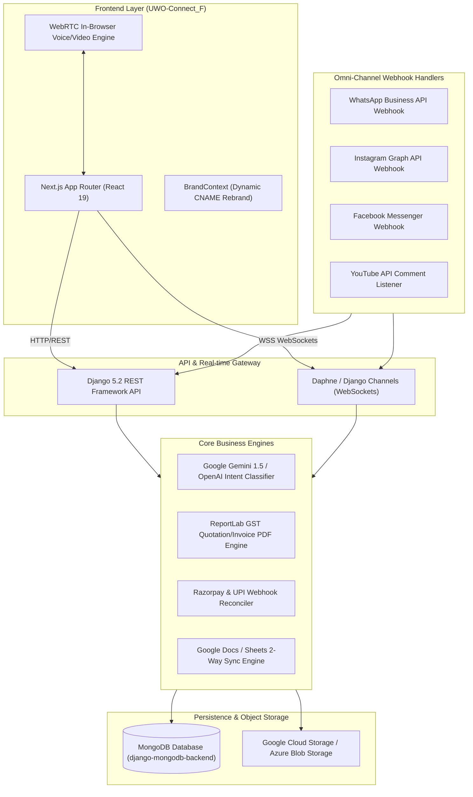
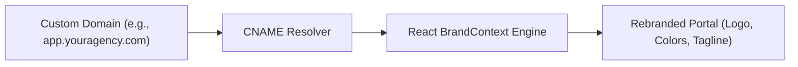

# 💻 UwoConnect — Exhaustive Technical Architecture & Developer Reference

> **Document Version**: 2.0.0 (Master Technical Specification)  
> **Target Audience**: Core Developers, Tech Leads, DevOps Engineers, and System Architects  
> **Codebase Scope**: `UWO-Connect_F` (Next.js Frontend) & `UWO-CONNECT_B` (Django Backend)

---

## 📑 Table of Contents
1. [System Architecture & Data Flow Diagram](#1-system-architecture--data-flow-diagram)
2. [Full Technology Stack Breakdown](#2-full-technology-stack-breakdown)
3. [Exhaustive Breakdown of 4 Communication Channels](#3-exhaustive-breakdown-of-4-communication-channels)
4. [Exhaustive Breakdown of 8 Data & App Connectors](#4-exhaustive-breakdown-of-8-data--app-connectors)
5. [Exhaustive Breakdown of 9 Core Automation Modules](#5-exhaustive-breakdown-of-9-core-automation-modules)
6. [White-Label Architecture & Multi-Tenant Engine](#6-white-label-architecture--multi-tenant-engine)
7. [Database Schema & Data Persistence Model](#7-database-schema--data-persistence-model)
8. [API Endpoints & Real-time Webhook Engine](#8-api-endpoints--real-time-webhook-engine)
9. [Local Environment Setup & Deployment Pipeline](#9-local-environment-setup--deployment-pipeline)

---

## 1. System Architecture & Data Flow Diagram

UwoConnect is engineered as a reactive, multi-tenant monorepo architecture. The frontend utilizes **Next.js 14/15** with dynamic brand context resolution, while the backend leverages **Django 5.2 (REST Framework & ASGI WebSockets)** connected to **MongoDB**.



---

## 2. Full Technology Stack Breakdown

### Frontend Stack (`UWO-Connect_F`)
* **Core Framework**: Next.js (App Router), React 19, JavaScript (ES6+ / Next CJS/ESM).
* **Styling & UI**: Tailwind CSS v4, Custom Glassmorphism UI tokens, Lucide React Icon suite (`lucide-react`).
* **State & Multi-Tenancy**: `BrandContext` for real-time dynamic CNAME domain resolution, custom logos, colors, and taglines.
* **Real-time & Media Engine**: Native WebSocket API for real-time inbox sync, WebRTC for P2P audio/video calls without third-party plugins.

### Backend Stack (`UWO-CONNECT_B`)
* **Core Framework**: Django 5.2 (`manage.py`).
* **ASGI Server & WebSockets**: Daphne / Uvicorn runner with `channels` (v4) for asynchronous WebSocket broadcasting.
* **Database & ORM**: MongoDB utilizing `django-mongodb-backend` (>=5.2.0) and PyMongo for high-speed unstructured data operations.
* **Security & Auth**: `djangorestframework-simplejwt` for stateless JWT token rotation.
* **PDF & Media Generation**: `ReportLab` engine for dynamic GST tax invoice & quotation PDF creation, `PyPDF2`, `python-docx`.
* **Cloud & Integrations**: `google-api-python-client`, `google-cloud-storage`, `azure-storage-blob`, `firebase-admin`, `resend`, `openai`, `requests`.

---

## 3. Exhaustive Breakdown of 4 Communication Channels

### 🟢 1. WhatsApp Business API
* **Integration**: Official Meta Graph API (v18.0+) via webhook endpoint `/api/channels/whatsapp/webhook/`.
* **Features**:
  * Auto-dispatches PDF brochures, rate cards, and product catalogs in response to inbound queries.
  * Interactive quick-reply buttons and catalog list messages.
  * Real-time message status webhooks (`sent`, `delivered`, `read`).
  * Bulk broadcast campaign manager with template message authorization.

### 📸 2. Instagram Direct Messages
* **Integration**: Meta Graph API for Instagram Messaging.
* **Features**:
  * Auto-DM on Reel and Post comments (Keyword-triggered DM replies).
  * Story mention detection with automated thank-you messages and lead magnets.
  * Private 1-on-1 Instagram DM auto-responses synced directly to the unified inbox.

### 🔵 3. Facebook Messenger
* **Integration**: Facebook Graph API Messenger Webhooks.
* **Features**:
  * Instant auto-reply to Facebook Page inquiries.
  * Facebook Lead Ads sync: Automatically extracts instant lead form submissions into CRM pipeline stages.
  * Media, image, and link payload dispatch.

### 🔴 4. YouTube Automation
* **Integration**: YouTube Data API v3.
* **Features**:
  * Automated comment monitoring on published videos.
  * Auto-reply to video comments containing specific keywords (e.g., "link", "price").
  * Lead capture tracking for viewers interacting via comments.

---

## 4. Exhaustive Breakdown of 8 Data & App Connectors

### 📧 1. Gmail Connector
* Syncs inbound/outbound email threads directly to contact CRM timelines.
* Automated email sequences for lead nurturing.
* Attachment extraction (PDFs, images) and automatic contact creation.

### 📬 2. Microsoft Outlook Connector
* Outlook email integration and calendar appointment sync.
* Automated meeting invite generation and schedule conflict detection.

### 📊 3. Google Sheets Connector
* Real-time 2-way data logging.
* Automatically appends new leads, deal stage updates, paid GST invoices, and transaction logs into specified Google Sheets.

### 📝 4. Google Docs Connector
* Dynamic document template generator.
* Auto-fills client information into contracts, NDAs, and proposals, exporting finalized PDFs for immediate sharing.

### 💳 5. Razorpay & Native UPI Connector
* Generates dynamic UPI payment links (PhonePe, Google Pay, Paytm, Razorpay) directly inside WhatsApp/Instagram chats.
* Real-time payment webhook verification (`payment.authorized`, `payment.failed`).
* Automatically triggers GST tax invoice creation upon payment confirmation.

### 🔌 6. Custom Webhooks & REST API Connector
* Inbound & outbound JSON webhooks.
* Connects seamlessly to external CRMs (Salesforce, HubSpot, Zoho), ERPs, and custom app backends.

### 📁 7. Local Storage & PDF File Vault Connector
* Secure file storage integrating Google Cloud Storage & Azure Blob Storage.
* Instant retrieval and attachment dispatch for PDF brochures, rate cards, and media assets.

### 📍 8. Google Maps & Location Services Connector
* Real-time location pin parsing sent by customers on WhatsApp.
* Automated distance calculation, store locator matching, and directions dispatch.

---

## 5. Exhaustive Breakdown of 9 Core Automation Modules

### 📊 Module 01: Team Dashboard
* Multi-user role-based access control (Admin, Manager, Support Agent).
* Real-time feed monitoring channel activity, active bot conversations, and open tickets.
* System status indicators and channel connection health monitors.

### 👥 Module 02: Unified CRM (Sales Pipeline)
* Automated lead capture from all 4 channels.
* Drag-and-drop Kanban sales deal pipeline (`New Lead` $\rightarrow$ `Contacted` $\rightarrow$ `Quotation Sent` $\rightarrow$ `Payment Received` $\rightarrow$ `Closed Won`).
* Automated lead scoring based on intent, conversation depth, and deal value.
* Complete contact timeline history with custom tagging.

### 🤖 Module 03: Smart AI Auto-Reply (Gemini Bot)
* 24/7 AI sales & customer support assistant operating at 0.2s response latency.
* Multilingual understanding & natural language processing (NLP).
* Intelligent catalog lookup, automated FAQ handling, and zero-delay human handover mode.

### 📄 Module 04: Quotation Generator
* Instant PDF quotation generation with itemized lists, custom discounts, and HSN/GST tax calculations.
* 1-click sharing of quotation PDFs directly to WhatsApp and Email conversations.
* Quotation expiry tracking and automated follow-up reminders.

### 🧾 Module 05: GST Invoicing Engine
* Automatic GST Tax Invoice PDF generation upon successful payment receipt.
* Automatic tax breakdown (CGST, SGST, IGST) based on billing state jurisdiction.
* Auto-sync of invoice metadata to Google Sheets, Tally, or accounting tools.

### 📝 Module 06: Proposal & Deals
* Interactive web proposals featuring dynamic pricing calculators.
* Native browser-based E-signature capture.
* Real-time view tracking (instant notifications when a client opens or reviews a proposal).

### 🛍️ Module 07: Product & Service Catalog
* Digital product showcase grid embedded inside chat windows.
* Category filtering, image galleries, price display, and stock indicators.
* 1-click WhatsApp cart checkout experience.

### 💳 Module 08: Payment Gateway Integration
* Native integration with Razorpay, PhonePe, Paytm, and direct UPI links.
* Zero-friction payment link generation inside chat workflows.
* Real-time webhook reconciliation and instant payment receipt generation.

### 📹 Module 09: HD WebRTC Voice & Video Calling
* In-browser HD voice and video calls between support agents and customers.
* Zero software or plugin download required for clients.
* Call logging, duration tracking, and screen-sharing support.

---

## 6. White-Label Architecture & Multi-Tenant Engine

UwoConnect features a built-in multi-tenant architecture designed for SaaS resellers and digital agencies.



### Key Technical Specs:
* **Dynamic CNAME Resolution**: Host the application on custom agency subdomains without revealing UwoConnect infrastructure.
* **Theme Injection (`BrandContext`)**: Injects custom primary colors (`#059669` default or custom HEX), logos, favicons, and copyright footers.
* **100% Profit Margin**: Agencies set custom client subscription pricing and collect revenues directly.
* **Multi-Tenant Dashboard**: Master agency panel to manage sub-accounts, allocate channel quotas, and monitor client usage.

---

## 7. Database Schema & Data Persistence Model

UwoConnect uses **MongoDB** via `django-mongodb-backend` for JSON-native document storage.

### Primary Collections:
* `users`: User authentication, roles, API keys, and brand context bindings.
* `contacts`: Customer details (name, phone, email, channel source, lead score, tags).
* `conversations`: Message logs across WhatsApp, Instagram, FB, and YouTube with timestamp metadata.
* `deals`: CRM pipeline stages, deal value, quotation references, and status.
* `quotations`: Itemized PDF quotation records, GST calculations, and expiration dates.
* `invoices`: GST Tax Invoice records, CGST/SGST/IGST breakdown, payment status, and Razorpay transaction IDs.
* `whitelabel_configs`: Agency custom domain mappings, logos, color codes, and CNAME settings.

---

## 8. API Endpoints & Real-time Webhook Engine

| Endpoint | Method | Description |
| :--- | :--- | :--- |
| `/api/auth/token/` | POST | Authenticate user & return SimpleJWT access/refresh tokens |
| `/api/channels/whatsapp/webhook/` | GET/POST | Meta Webhook challenge verification & inbound message receiver |
| `/api/channels/instagram/webhook/` | GET/POST | Instagram DM & comment webhook listener |
| `/api/crm/leads/` | GET/POST | Query lead pipeline stages or create new CRM lead |
| `/api/quotations/generate/` | POST | Generate GST PDF quotation & return download/share link |
| `/api/invoices/issue/` | POST | Issue official GST Tax Invoice PDF |
| `/api/payments/create-link/` | POST | Generate Razorpay / UPI payment link |
| `/api/whitelabel/config/` | GET | Resolve CNAME branding configuration by HTTP Host header |

---

## 9. Local Environment Setup & Deployment Pipeline

### Prerequisites
* **Node.js**: v18.0+
* **Python**: v3.10+ (Recommended Python 3.12)
* **MongoDB**: Running local MongoDB (`mongodb://localhost:27017`) or Atlas URI.

### 1. Frontend Setup (`UWO-Connect_F`)
```powershell
cd UWO-Connect_F
npm install
npm run dev
```
*Frontend running at `http://localhost:3000`*

### 2. Backend Setup (`UWO-CONNECT_B`)
```powershell
cd UWO-CONNECT_B

# Install dependencies via Python module (bypasses Windows pip.exe policy restrictions)
python -m pip install -r requirements.txt

# Run migrations & start Django server
python manage.py migrate
python manage.py runserver
```
*Backend running at `http://127.0.0.1:8000`*

---

## 10. Exhaustive Wallet & Razorpay Broadcast Entitlement System

### Architecture & Business Model
1. **Subscription vs. Prepaid Usage Wallet**:
   * **Subscription (₹499/mo)**: Managed separately for platform access and plan included entitlements; **never** deducted from usage wallet.
   * **Prepaid Usage Wallet**: Dedicated ledger for metered costs (WhatsApp Meta messaging, AI API calls, additional broadcasts).
   * **100% Direct Credit**: 100% of user recharge is credited directly to balance (no forced markup or automatic bonus).

2. **Razorpay Recharge Flow**:
   * **Order Creation**: `POST /api/wallet/recharge/create/` creates a `WalletRechargeOrder` with `status='PENDING'`.
   * **Razorpay Checkout Modal**: Frontend launches `window.Razorpay(options).open()` with `key: RAZORPAY_KEY_ID`, `amount: amount_paise`, `order_id: razorpay_order_id`, and prefill details.
   * **Payment Methods Supported**: UPI (GPay, PhonePe, Paytm, BHIM), Credit/Debit Cards (Visa, Mastercard, RuPay), NetBanking (SBI, HDFC, ICICI, Axis & 50+ Banks), and Wallets.

3. **Backend Signature Verification & Webhooks**:
   * `POST /api/wallet/recharge/verify/` validates HMAC signature (`razorpay_signature`).
   * Webhook endpoint `/api/payments/razorpay/webhook/` handles `payment.captured` & `order.paid`.
   * **Idempotency**: `select_for_update()` row locking guarantees that duplicate callbacks or webhooks do NOT double-credit the wallet.

4. **Immutable Wallet Ledger**:
   * Successful payment creates a permanent `WalletLedger` record:
     * `type`: `RECHARGE`
     * `amount_paise`: `+100000` (for ₹1,000)
     * `status`: `SUCCESS`
     * `reference_id`: `rcpt_w_...`

5. **Broadcast Entitlements & Metered Consumption**:
   * **Included Broadcasts**: Subscription plans include free broadcasts per billing cycle.
   * **Wallet Paid Broadcasts**: Additional broadcasts beyond included count cost ₹0.94 from usage wallet.
   * **Unlock Criteria**: Additional broadcast entitlement (`can_broadcast`) unlocks **only** after wallet recharge is confirmed and `wallet_balance_inr >= 0.94`.
   * **Execution**: Recharging balance does **NOT** automatically send a broadcast. Launching a broadcast executes `/api/broadcasts/consume/` to record a `USAGE` ledger debit of ₹0.94.

---

*Technical Reference Version: 2.1.0 | UwoConnect Monorepo Specs*
